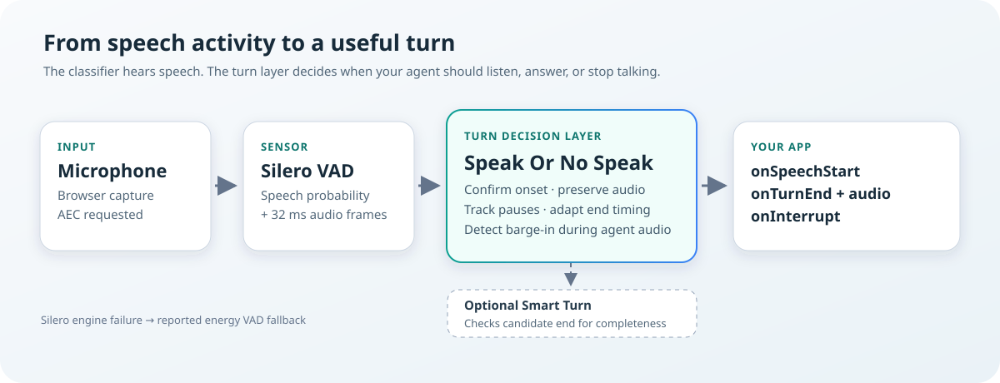

# Speak Or No Speak

### Know when a person starts talking, finishes a thought, or interrupts your voice agent.

**Speak Or No Speak** is a browser JavaScript module for **conversational
turn taking**. It listens to the microphone and tells your voice application
the three moments it needs to know about — the user **started speaking**, the
user **finished a turn** (with that utterance's audio attached, ready for
transcription), and the user **barged in while the agent was answering**.
It runs entirely in the browser, on the user's device: no backend, no keys,
no audio uploaded for detection.

<p align="center"></p>

<p align="center">
  <a href="https://zushicat.github.io/speak-or-no-speak-dev/">Try the live demo</a> ·
  <a href="docs/README.md">Read the guide</a> ·
  <a href="demos/">Explore the demo code</a>
</p>

## The problem, in plain English

When two people talk, taking turns is automatic. For a computer it is not.
Somewhere in every voice app a component must answer three questions hundreds
of times per second — and each one looks trivial and is not:

1. **Is the user speaking right now?** A cough or a keyboard click must not
   count as speech; a real onset must be reported within about a third of a
   second.
2. **Has the user finished their thought?** A pause inside a sentence
   ("let me think… okay, so") must *not* end the turn — but a real end must be
   picked up quickly. A fixed wait time is either too slow or too
   trigger-happy.
3. **Is the user talking over the answer?** While the agent speaks, the mic
   must keep listening and report the barge-in within a fraction of a second —
   without mistaking the agent's own voice for the user.

A plain speech detector (a VAD) only answers question 1. Speak Or No Speak
uses the open [Silero VAD](https://github.com/snakers4/silero-vad) under the
hood and adds the layer that actually matters for conversation: **adaptive
turn-taking, interruption detection, and echo safety.**

**What it is not:** no transcription inside (it hands you the audio and a
plug point connects your STT), no chatbot brain, no text-to-speech, no wake
words, no mobile support yet. Your app stays in charge of understanding and
answering — this module is its "ears".

| Your app gets | Event |
|---|---|
| "The user started speaking" | `onSpeechStart` |
| "The utterance is complete — here is the audio" | `onTurnEnd` (16 kHz mono `Float32Array`, incl. a 200 ms pre-speech pad) |
| "The user barged in while the agent was talking" | `onInterrupt` |

## Try it

The [live demo](https://zushicat.github.io/speak-or-no-speak-dev/) runs the
full page — microphone detection, background noise, computer voice, optional
transcription — straight from GitHub Pages:

<p align="center"><a href="https://zushicat.github.io/speak-or-no-speak-dev/"></a></p>

Or run it from a checkout:

```bash
npm start
```

Then open <http://localhost:5173/demos/> and click **Start microphone**.
(Microphone access requires `http://localhost` or HTTPS, and the first load
fetches two pinned runtime libraries from the CDN.) The
[quick start](docs/02-quick-start.md) walks through everything you will see.

## Architecture

Mic → Silero VAD frames (32 ms) → a pure turn state machine (onset
confirmation, adaptive end-of-turn window, barge-in confirmation) → your
events. A degraded energy-based fallback engine keeps detection alive if the
neural engine cannot load, and every degradation is flagged, never silent.


The components and data flow can be explored interactively in the
[architecture app](docs/archify/speak-or-no-speak.architecture.html) — open it
directly in a browser, no server needed.

## Documentation

| You want to … | Read |
|---|---|
| Understand what this is, in plain words | [1 What is Speak Or No Speak?](docs/01-plain-english.md) |
| See it running right now | [2 Quick start](docs/02-quick-start.md) → [3 The demo page](docs/03-demo-page.md) |
| Put the module into your own app | [4 Use it in your own app](docs/04-use-in-your-app.md) → [5 API reference](docs/05-api-reference.md) |
| Build a talking agent (TTS + barge-in) | [6 Agent integration](docs/06-agent-integration.md) |
| Understand how detection works under the hood | [7 How detection works](docs/07-how-detection-works.md) → [8 Architecture](docs/08-architecture.md) → [9 Engines and runtime libraries](docs/09-engines-and-libraries.md) |
| Use the optional extras | [10 Smart Turn](docs/10-smart-turn.md) · [11 Transcription](docs/11-transcription.md) |
| Tune thresholds or debug behavior | [12 Configuration & tuning](docs/12-tuning.md) → [13 Troubleshooting](docs/13-troubleshooting.md) |
| Work on the source code | [14 Development: build, test & publish](docs/14-development.md) |
| Learn why it was designed this way | [15 Design background](docs/15-design-background.md) |
| Look up a term | [Glossary](docs/appendix-glossary.md) |

## The essentials at a glance

- **Integration:** zero-build ES modules, a prebuilt ESM or IIFE single-file
  bundle, or npm — [Use it in your own app](docs/04-use-in-your-app.md)
- **On-device & private:** all detection is local; audio leaves the machine
  only if *your* transcription does — [Transcription](docs/11-transcription.md)
- **Honest degradation:** energy-engine fallback, echo-cancellation scope
  reporting, fail-open turn model — [Troubleshooting](docs/13-troubleshooting.md)
- **Browsers:** desktop Chrome / Edge / Safari; mobile is out of scope for now
- **License:** MIT
