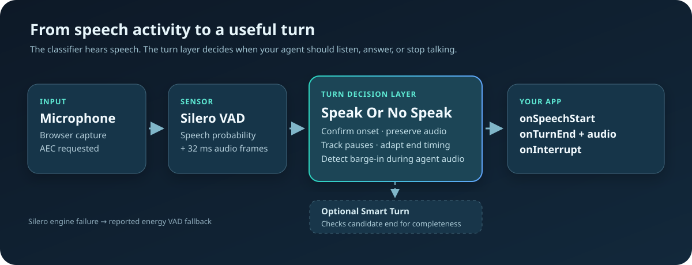
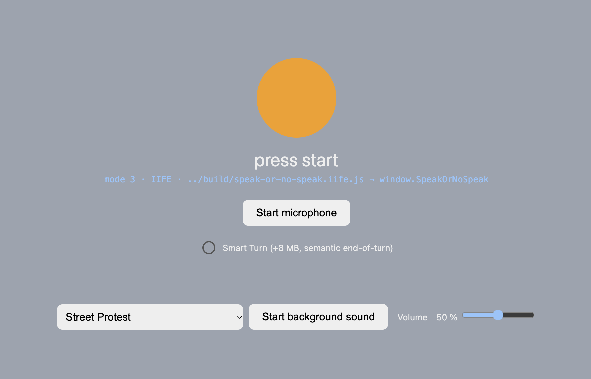
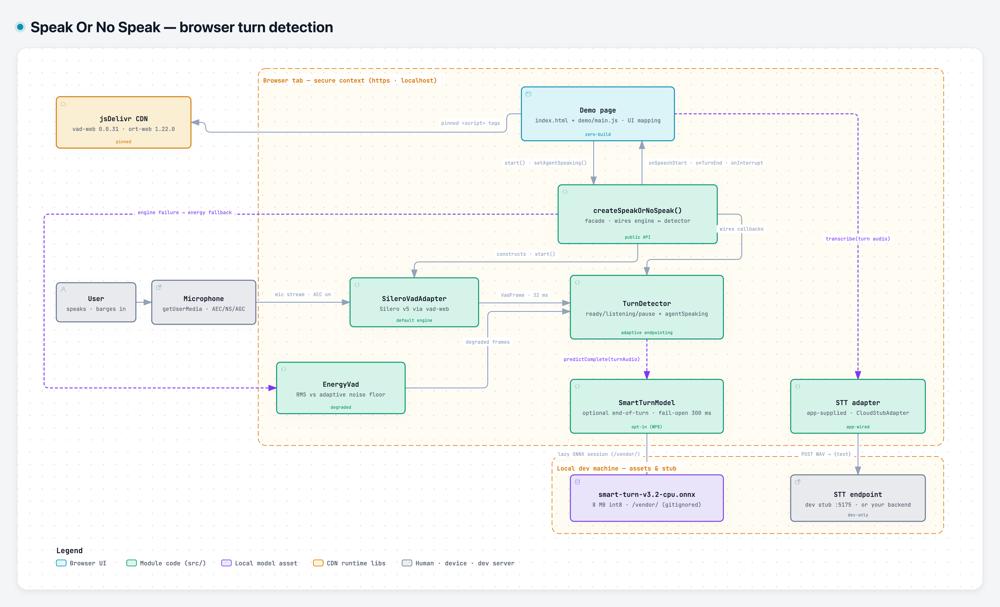

# Speak Or No Speak

### Know when a person starts talking, finishes a thought, or interrupts your voice agent.

Speak Or No Speak is a browser JavaScript layer for **conversational turn taking**. It takes microphone frames from Silero VAD and turns them into three useful events: speech started, user turn ended, and user interrupted the agent. It keeps the audio for each completed turn so your app can send it to transcription.

<p align="center"></p>

<p align="center"><a href="https://zushicat.github.io/speak-or-no-speak-dev/">Try the live demo</a> · <a href="docs/README.md">Read the guide</a> · <a href="demos/simple-demos/">Explore the demo code</a></p>

## Why use it?

A voice activity detector can tell you whether a frame sounds like speech. A talking agent needs more: a brief pause may be part of the same thought, and speech during the agent's answer may be an interruption. Wiring basic speech-start and speech-end callbacks to an agent leaves those decisions to your application.

| What your app needs | What this project does |
| --- | --- |
| Decide when to answer | Uses a silence window that adapts to the current turn's speaking rhythm; interior pauses can remain one turn. |
| Let the user interrupt | Has a dedicated agent-speaking mode and emits `onInterrupt` after confirmed speech. |
| Keep the whole utterance | Buffers audio before speech onset and accumulates 16 kHz mono PCM through the end of the turn. |
| Handle echo and engine failure | Requests the widest browser echo-cancellation scope, reports what the browser actually cancels (`degraded.aecScope`), ships a route that makes your agent's own audio cancelable on every browser, applies stricter interruption gating without AEC, and reports when it falls back from Silero to energy detection. |
| Add language awareness when needed | Can ask an optional turn model whether an acoustically finished utterance sounds complete. |

**Compared with using [`@ricky0123/vad-web`](https://github.com/ricky0123/vad) alone:** this project uses the same Silero speech classifier and adds turn timing, pause handling, interruption mode, and accumulated turn audio. It does not claim a more accurate underlying speech classifier. It also does not transcribe speech or generate replies; you connect your own STT, agent, and audio output.

**Echo-cancellation honesty (measured, per browser):** a browser cancels exactly the audio it can *reference*. Chromium without the `"all"` scope cancels only WebRTC-remote audio — your `speechSynthesis` TTS leaks into the mic; the module reports this (`degraded.aecScope`) and ships `createAgentAudioRoute()` to fix it. Other apps' audio is only cancelled by OS-level AEC ([Chapter 6 §6.6](docs/06-agent-integration.md#66-echo-cancellation-scope), [§6.10](docs/06-agent-integration.md#610-os-level-echo-cancellation)).

## Try it locally

```bash
npm start
```

Open [http://localhost:5173/demos/simple-demos/](http://localhost:5173/demos/simple-demos/) and click **Start microphone**. You can also run `npm run start:serve`. The demo has optional background sounds to exercise detection under noise. Microphone access requires localhost or HTTPS, and the default Silero path loads pinned browser libraries and model assets from jsDelivr.

The **Hey, Buddy! chat demo** — a standalone static app at
[`demos/hey-buddy/`](demos/hey-buddy/) — runs from the same server: open
[http://localhost:5173/demos/hey-buddy/](http://localhost:5173/demos/hey-buddy/).
It is a full conversation (turn → STT → LLM → speech) and needs the local
parakeet STT server on `:18001` and LM Studio (`--cors`) on `:1234`; see its
[README](demos/hey-buddy/README.md).

## Use it in a page

The source version needs the two browser runtime scripts shown below. Call `start()` from a click or another user gesture. See [Getting started](docs/02-getting-started.md) for bundles and npm use.

```html
<script src="https://cdn.jsdelivr.net/npm/onnxruntime-web@1.22.0/dist/ort.wasm.min.js"></script>
<script src="https://cdn.jsdelivr.net/npm/@ricky0123/vad-web@0.0.31/dist/bundle.min.js"></script>
<button id="start">Start listening</button>
<script type="module">
  import { createSpeakOrNoSpeak } from "./src/index.js";

  function stopAgentAudio() { /* stop your app's TTS playback here */ }

  const listener = await createSpeakOrNoSpeak({
    onSpeechStart: () => console.log("The user is speaking"),
    onTurnEnd: ({ audio, afterInterrupt }) => {
      // audio is 16 kHz mono Float32Array, ready for your STT pipeline.
      console.log("Turn complete", audio.length, { afterInterrupt });
    },
    onInterrupt: () => {
      stopAgentAudio();                 // your synchronous playback stop
      listener.setAgentSpeaking(false); // disarm after output stops
    },
    onError: ({ code, message }) => console.warn(code, message),
  });

  document.querySelector("#start").addEventListener("click", () => listener.start());

  // When your agent begins audio output: listener.setAgentSpeaking(true)
  // When its audio output ends: listener.setAgentSpeaking(false)
</script>
```

The `onInterrupt` callback signals an interruption; the user's audio arrives later in `onTurnEnd` with `afterInterrupt: true`. Always clear the agent-speaking flag when playback has actually stopped. [Agent integration](docs/06-agent-integration.md) shows a complete lifecycle.

## Documentation

1. [Start and choose an embedding mode](docs/01-getting-started.md)
2. [Understand the turn decisions](docs/02-how-it-works.md)
3. [Connect a talking agent and transcription](docs/03-agent-integration.md)
4. [Use the API and tune defaults](docs/04-api-and-configuration.md)
5. [Understand the architecture and optional model](docs/05-architecture-and-extensions.md)
6. [Diagnose failures and limitations](docs/06-troubleshooting.md)

## Misc
- Read the [documentation](docs/README.md)
    - [Read here](docs/03-demo.md) how to start the [simple demos](demos/simple-demos)
- [Inspect the architecture](docs/archify/speak-or-no-speak.architecture.html)

### Demo
Check out the running demo: [https://zushicat.github.io/speak-or-no-speak-dev/](https://zushicat.github.io/speak-or-no-speak-dev/)


#
### Architecture
