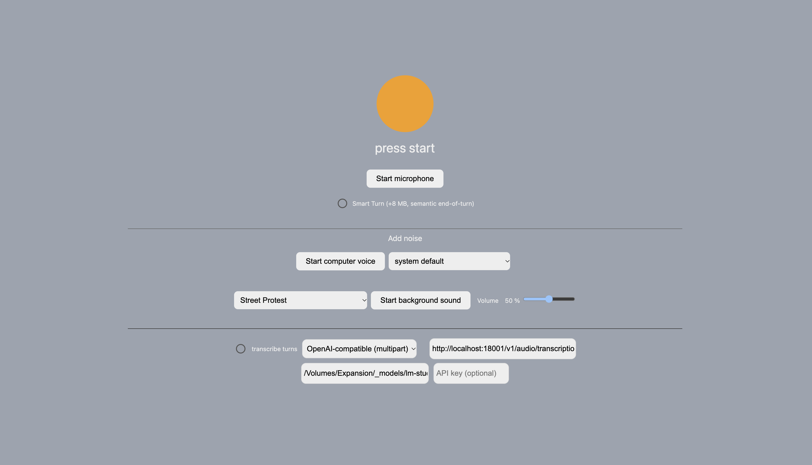

# The demo page

> Part of the [Speak Or No Speak documentation](README.md) · prev: [Quick start](02-quick-start.md) · next: [Use it in your own app](04-use-in-your-app.md)

The demo at <http://localhost:5173/demos/> is the module's showcase — and a
template for your own integration. It is deliberately **wiring only**:
[`demos/main.js`](../demos/main.js) maps module events to the page and contains
**no detection logic**. Every onset/turn/barge-in decision lives inside the
module.

## Page anatomy

Every element of [`demos/index.html`](../demos/index.html), top to bottom:

| Element | What it does |
|---|---|
| **Indicator dot + label** | A big dot (orange = idle, green = a turn is open) with a status label: `press start` → `starting…` → `listening` / `not listening`. |
| **Start microphone button** | Starts and stops the microphone (a toggle; it stays visible and switches its label). |
| **Smart Turn checkbox** | Enables the optional semantic end-of-turn model (+8 MB asset, [Smart Turn](10-smart-turn.md)). Disabled while the mic runs; the model instance is cached so start/stop cycles do not reload it. |
| **Error line** | Red text with a human-readable message for every problem the module reports. |
| **Debug line** | Dimmed mono line with the last measurement, e.g. `turn: 1.4 s`, `barge-in after 1922 ms (latency 192 ms)`. |

Below the debug line sits the **"Add noise"** section — the two rows that put
sound into the room on purpose:

| Element | What it does |
|---|---|
| **Computer voice row** | *Start computer voice* + a **voice source** select + a **voice picker**. Two sources: `speechSynthesis` (the browser's built-in TTS) and `audio buffer (routed)` (a sample WAV played through the module's echo-cancelable audio route). The small blue note shows the resolved route mode (`route: loopback` / `route: direct`). |
| **Background sound row** | A select with five ambient recordings (street protest, crowd, street sounds, playground, people talking), a start/stop button, and a volume slider (default 50 %). |
| **Transcription row** | Hidden until the microphone runs: a *transcribe turns* checkbox, a **backend mode** select (*OpenAI-compatible (multipart)* or *Stub (WAV body → JSON)*), an endpoint field, a model field (only relevant in OpenAI-compatible mode), and an optional API-key field. |
| **Event log** | Timestamped lines (newest first, last 20): turns, barge-ins, transcription results (`💬 "…" (90%) · mode`), transcription failures, and background-sound errors. |

The `<head>` loads the two **pinned runtime libraries** from the CDN
(`onnxruntime-web` 1.22.0 and `vad-web` 0.0.31). They register globals that
only the module's engine adapter reads — see
[Engines and runtime libraries](09-engines-and-libraries.md).

## The listening indicator

The dot and label map module events directly:

| UI state | Trigger | Meaning |
|---|---|---|
| orange, "press start" | page load / after stop | microphone not running |
| orange, "not listening" | after start / after a turn ends | detector running, no open turn |
| green, "listening" | speech started | a turn is open |
| green (unchanged) | short interior pause | the turn is **still open** — pauses never end it early |

One subtlety: a discarded "turn" (a cough shorter than the minimum speech
time) flips the dot back to orange **without any event**. For authoritative
state, read the module's `state` getter instead of the UI
([API reference](05-api-reference.md)).

## The computer voice row — an echo experiment

The *Start computer voice* button makes the page speak a sentence out loud,
with two possible sources:

1. **`speechSynthesis`** — the browser's built-in text-to-speech. Its output
   *cannot* be captured by web audio, so on Chromium without the OS recording
   permission it **leaks into the microphone** — you will see the dot react to
   the computer's voice. That is the honest demonstration of the echo hazard.
2. **`audio buffer (routed)`** — a sample WAV played through the module's
   `createAgentAudioRoute()`: a local loopback that makes the browser classify
   the page's own audio as "remote participant" audio — the one source its
   echo cancellation always removes. With this source the dot should stay
   orange while the computer talks, on every browser.

The voice dropdown picks among the system's TTS voices (applies to the
`speechSynthesis` source only).

Important: the demo **never** tells the module "the agent is speaking"
(`setAgentSpeaking`). It is an *echo test*, not a barge-in simulation — the
demo shows whether the microphone hears the computer's voice, not how the
interrupt event fires. Barge-in is covered in
[Agent integration](06-agent-integration.md).

The route itself is created inside the mic-start click (browsers require a
user gesture for that) and stopped when the microphone stops.

## The background sound row — noise on purpose

The row plays one of five ambient recordings from
[`demos/assets/`](../demos/assets/sources.md) on a loop, with its own volume
slider. All sounds are from [Pixabay](https://pixabay.com/) under the Pixabay
Content License (original filenames and license notes in
[`sources.md`](../demos/assets/sources.md)).

Like the computer voice, the background sound is deliberately **not** declared
as "agent speaking": it is supposed to reach the detector as plain ambient
noise, so you can test noise robustness. The detector should not produce turns
from a protest crowd.

## The transcription row

Once the microphone runs, the row appears:

- **Backend mode** — two request shapes:
  - *OpenAI-compatible (multipart)*: sends the turn as `multipart/form-data`
    (`file` = WAV, optional `model`), with `Authorization: Bearer …` when an
    API key is set. Works with LM Studio, Groq, OpenAI, and any server
    speaking the `/v1/audio/transcriptions` dialect.
  - *Stub (WAV body → JSON)*: sends the raw WAV body and expects
    `{ "text": "…", "confidence": 0..1 }` back — the shape of the shipped
    `CloudStubAdapter` and the Python stub server below.
- **Endpoint field** — default `http://localhost:6000/transcribe` (the stub
  server). Any endpoint accepting the request shape works.
- **Model field / API key field** — model id for the OpenAI-compatible mode;
  optional bearer token. Settings (including the key) persist in this
  browser's `localStorage` — a dev-demo convenience, *never* a pattern for
  production ([Transcription § privacy](11-transcription.md#privacy-and-security-notes)).

The wiring is the reference pattern of the transcription plug point: on every
**turn end**, the page fire-and-forgets a transcription request with a
`.catch` that logs — a transcription failure can never affect detection.

### The Python stub server

[`demos/simple-demos/stt-stub-server.py`](../demos/simple-demos/stt-stub-server.py)
is a dev-only mockup, not a speech recognizer:

- listens on `http://localhost:6000/transcribe` (port = first CLI argument);
- `POST /transcribe` checks whether the body starts with the `RIFF` magic
  (i.e. is a WAV) and answers with a **canned** JSON payload —
  `"(stub) recognized turn audio"` with confidence 0.9 for a WAV body;
- answers `OPTIONS` with permissive CORS headers so the browser page can call it.

It runs no model and does no audio processing; its only real check is the
4-byte `RIFF` magic. It exists so the demo's transcription wiring can be
exercised end-to-end without a real backend.

## URL parameters

| Parameter | Effect |
|---|---|
| `?noaec=1` | Forces `echoCancellation: false` on the microphone — exercises the no-echo-cancellation branch (warning, stricter barge-in gating) on any machine. |
| `?routemode=loopback\|direct` | Forces the agent-audio route mode, overriding the automatic choice (Safari → direct, otherwise loopback). |

(The page also cache-busts its script with a `main.js?v=6` query — bump it
when editing `demos/main.js`, because the dev server sends no cache headers.)

## Bundle variants of the demo

The exact same page ships in three more flavors, useful to see how the module
reaches a browser in different setups:

| Page | Module source | What it demonstrates |
|---|---|---|
| [`demos/index.html`](../demos/index.html) | the source modules in `src/` | zero-build development (the default demo) |
| [`demos/demo-esm-bundle.html`](../demos/demo-esm-bundle.html) | the prebuilt **ESM bundle** from `build/` | one-file import for module-based pages |
| [`demos/demo-iife-bundle.html`](../demos/demo-iife-bundle.html) | the prebuilt **IIFE bundle** → global `window.SpeakOrNoSpeak` | one-file `<script>` for non-module pages |
| [`demos/demo-simplified-iife-bundle.html`](../demos/demo-simplified-iife-bundle.html) | the IIFE bundle **from the CDN** | the module loaded entirely from a published URL |

Serve the checkout (`npm start`) and open e.g.
<http://localhost:5173/demos/demo-iife-bundle.html>. Everything in this
chapter (page behavior, `?noaec=1`, experiments) applies to them unchanged.
The **live demo** at <https://zushicat.github.io/speak-or-no-speak-dev/> is
the IIFE-bundle flavor, deployed from `dist/`.

## Suggested experiments

1. **Noise robustness:** start the mic, play *Street Protest* at 50 %, and
   speak — turns should still be your speech, not the crowd.
2. **Echo comparison:** start the computer voice with `speechSynthesis`, then
   with `audio buffer (routed)` — and repeat with and without `?noaec=1`.
   Watch which sources make the dot react.
3. **Endpointing:** say *"let me think … okay, go now"* — the whole thing
   should arrive as **one** turn; with Smart Turn enabled, even longer
   thinking pauses should not split it.
4. **Timing:** watch the debug line (`turn: N s`) and open the browser console
   — the facade instance is exposed as `window.__sons` while the mic runs, and
   `window.__sons._detector.traces` (with `debug: true`) shows the state
   machine's decisions.
5. **Distance:** step two meters away from the microphone and check that
   turns still form.

---

*Prev: [Quick start](02-quick-start.md) · Next: [Use it in your own app](04-use-in-your-app.md)*
