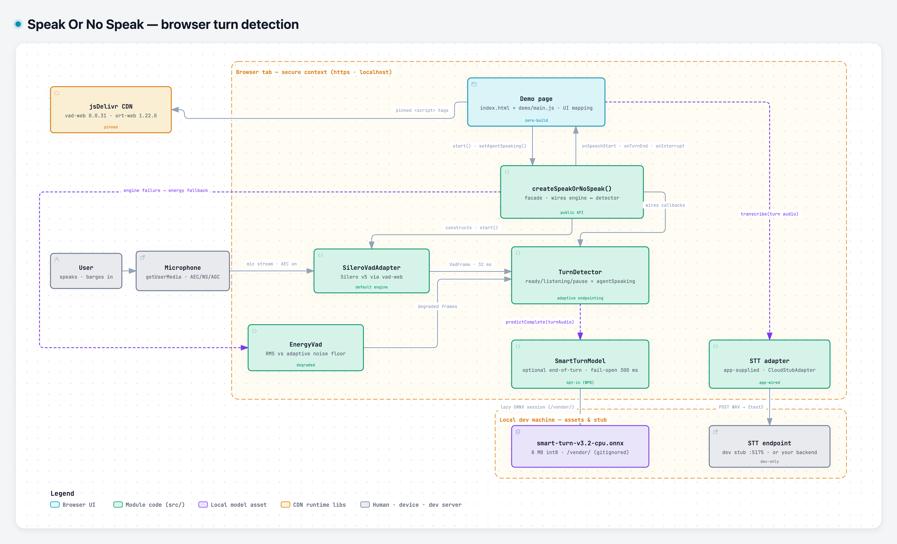

# Architecture

> Part of the [Speak Or No Speak documentation](README.md) · prev: [How detection works](07-how-detection-works.md) · next: [Engines and runtime libraries](09-engines-and-libraries.md)

## Component map



The components and their roles:

| Component | Where | Role |
|---|---|---|
| User → Microphone | outside the page | speaks · barges in; `getUserMedia` with AEC/NS/AGC |
| jsDelivr CDN | external, pinned | `vad-web` 0.0.31 + `onnxruntime-web` 1.22.0 via `<script>` tags |
| Demo page | `demos/index.html` + `demos/main.js` | UI mapping only (browser tab, secure context) |
| `createSpeakOrNoSpeak()` | [`src/speak-or-no-speak.js`](../src/speak-or-no-speak.js) | facade · wires engine ↔ detector · public API |
| `SileroVadAdapter` | [`src/vad/silero-vad-adapter.js`](../src/vad/silero-vad-adapter.js) | default engine — Silero v5 via vad-web; emits a frame every 32 ms |
| `EnergyVad` | [`src/vad/energy-vad.js`](../src/vad/energy-vad.js) | degraded fallback — RMS vs adaptive noise floor |
| `TurnDetector` | [`src/turn/turn-detector.js`](../src/turn/turn-detector.js) | ready/listening/pause × agentSpeaking state machine · adaptive endpointing |
| `SmartTurnModel` | [`src/turn-model/smart-turn.js`](../src/turn-model/smart-turn.js) | optional end-of-turn · fail-open 300 ms · lazy ONNX session from `/vendor/` |
| STT adapter | [`src/stt/`](../src/stt/stt-adapter.js) | app-supplied (`CloudStubAdapter` example) · app-wired, outside the real-time loop |
| STT endpoint | dev stub on `:6000` or your backend | POST WAV → `{text}` — the stub is dev-only |

## End-to-end data flow

```
mic ──getUserMedia(AEC/NS/AGC)──► vad-web capture (AudioWorklet or
                                   ScriptProcessor, resampled to 16 kHz)
        │
        ▼  frame every 32 ms {probability, frame, rms, durationMs}
  TurnDetector.onFrame ── state machine (How detection works) ──┬─► onSpeechStart
        │                                                       ├─► onTurnEnd (+audio)
        │                                                       └─► onInterrupt
        └─ every frame also: onLevel(rms) → UI meter
```

Everything above the mic lives inside the browser tab; nothing leaves the
device. The engine is replaceable behind one interface, and the detector is a
pure function of the frame stream plus the agent flag.

## The engine abstraction

[`src/vad/vad-engine.js`](../src/vad/vad-engine.js) defines the contract every
engine implements:

```js
interface VadEngine {
  start():  Promise<void>;  // load model + open mic; resolves on first frame
  stop():   void;           // release everything
  pause():  void;  resume(): void;
  onFrame(cb: (frame: VadFrame) => void): void;
  onError(cb: (err: {code, message}) => void): void;
}
```

Two rules make the abstraction work:

- **Engines never decide turns.** They emit frames; the `TurnDetector` is the
  single consumer of the stream and the only owner of turn semantics.
- **Implementations must stay importable in Node** (no top-level
  `window`/`navigator` access — guarded inside `start()`), so the whole
  detection core is unit-testable without a browser.

## The facade wiring

[`createSpeakOrNoSpeak`](../src/speak-or-no-speak.js) does exactly four things:

1. **Merges options** over `DEFAULTS` (`mergeOptions` — per-key recursive
   merge for objects, replacement for everything else).
2. **Constructs** the engine (default `SileroVadAdapter` with the merged mic
   constraints) and the `TurnDetector` (thresholds, debug flag, optional
   `turnModel`, echo-gate and half-duplex options).
3. **Wires the streams**: engine `onFrame` → `detector.onFrame` + `onLevel`
   (+ the optional voice-gate window feed); engine `onError` → your `onError`.
4. **Implements the degradation ladder in `start()`**: if the Silero engine
   throws `engine-load-failed`, `cdn-unavailable`, or `audio-pipeline`, and a
   fallback is allowed (no injected `engine`, or an explicit `energyEngine`
   was provided), it stops the failed engine, emits a one-time
   `engine-fallback` warning, switches to `EnergyVad`, and starts again.
   Mic/permission/context failures are **fatal** — no fallback can help.
   After start, the detector's stricter-gating mode is set from the engine's
   honest AEC scope × the agent-audio-route declaration × the `strictGating`
   option ([Agent integration](06-agent-integration.md#without-aec--the-stricter-gating)).

## A pure state machine — on purpose

`TurnDetector` has **no `window`/`document` access** and no wall-clock
dependencies: all timing derives from `frame.durationMs` (audio time). That
buys three things:

- the full machine is unit-tested in Node with synthetic frame sequences
  ([`test/unit/turn-detector.test.js`](../test/unit/turn-detector.test.js)),
- calibration recordings can be **replayed deterministically** through any
  configuration ([Development § replay](14-development.md#the-replay-harness-and-calibration-recordings)),
- bursty frame delivery (2–3 frames per buffer on some paths) cannot skew
  timing — the machine counts audio time, not callback time.

## The audio capture pipeline

The Silero adapter's capture path (details in
[Engines and runtime libraries](09-engines-and-libraries.md)):

1. `getUserMedia({ audio: AEC_CONSTRAINTS })` — **our** stream, passed to
   vad-web via its documented `getStream` override, so the AEC/NS/AGC
   constraints apply to the exact stream the engine consumes.
2. Track settings are inspected and classified into the honest AEC scope
   (`all` / `remote-only` / `unknown` / `none`); scope `none` → `no-aec`
   warning and stricter barge-in gating.
3. vad-web runs its own AudioContext at the device rate (typically 48 kHz) and
   resamples to 16 kHz internally; frames are model-derived 512 samples
   (32 ms).
4. Capture uses vad-web's default AudioWorklet path; if the worklet module
   load hangs, the adapter retries with the legacy ScriptProcessor path
   (see [the worklet hang](09-engines-and-libraries.md#the-audioworklet-hang-and-the-scriptprocessor-fallback)).

The energy engine's pipeline is deliberately worklet-free:
`getUserMedia → AudioContext → ScriptProcessor(4096) → box-average downsample
to 16 kHz → 512-sample frames → RMS probability`.

## Threading model

**Main-thread inference is fine — measured.** The frame handler chain
(capture → resample → Silero inference → callbacks) was probed at
**p50 ≈ 0 ms / p95 = 0.3 ms / max 3.9 ms** per frame (2033-frame probe over
60 s) against an 8 ms budget — met with a >20× margin. A worker is therefore
**not needed**; if a target machine ever exceeded the budget, the recipe would
be to move capture + inference into a Worker with the same facade API.

Caveats worth knowing:

- **Multi-threaded WASM** (`ort-wasm-simd-threaded`) needs cross-origin
  isolation (`Cross-Origin-Opener-Policy: same-origin` +
  `Cross-Origin-Embedder-Policy: require-corp` headers). **Single-threaded
  WASM is the tested default** and needs no special headers.
- AudioWorklet inside workers: prefer the `ScriptProcessor` path there too
  (the worklet hang affects some builds).

## Design decisions and their reasons

| Decision | Why |
|---|---|
| Own state machine instead of vad-web's `onSpeechStart`/`onSpeechEnd` | vad-web's segmentation is a fixed silence timeout: no adaptive endpointing, no barge-in mode, no pause sub-state, no pad control. The adapter consumes **frames only**; vad-web's own callbacks stay unwired by design. |
| Energy fallback instead of hard failure | A blocked CDN or a failed model load must not kill the page — a degraded detector that *works* beats a dead one, as long as the degradation is flagged (`degraded.engine`). |
| Fail-open turn model | The Smart Turn model can only *hold* a turn, never lose one: errors/timeouts emit the turn end ([Smart Turn](10-smart-turn.md#when-it-runs-and-fail-open-semantics)). |
| STT strictly outside the real-time loop | STT latency/failures must never affect detection; the module ships no engine and never calls adapters itself ([Transcription](11-transcription.md)). |
| Browser AEC as the echo groundwork + the agent-audio route | The browser cancels **what it can reference** — `RTCPeerConnection` audio on Chrome/Edge/Firefox by default; same-page audio needs the route (`createAgentAudioRoute`) or the `"all"` scope + the OS permission; Safari's system AEC covers everything. Measured per-browser table: [Agent integration](06-agent-integration.md#echo-cancellation-scope--the-reference-signal-rule). Statistical gating covers the rest. |
| Main thread instead of a worker | Measured p95 0.3 ms against an 8 ms budget; a worker adds cross-origin-isolation requirements and complexity for no measured need. |
| Zero-build source layout | Plain ES modules from a static server keep the dev loop free of toolchains; the bundle ([Development](14-development.md)) serves consumers who want one file. |
| Every threshold is an option | No hidden constants — apps tune per environment from documented defaults ([Tuning](12-tuning.md)). |

---

*Prev: [How detection works](07-how-detection-works.md) · Next: [Engines and runtime libraries](09-engines-and-libraries.md)*
