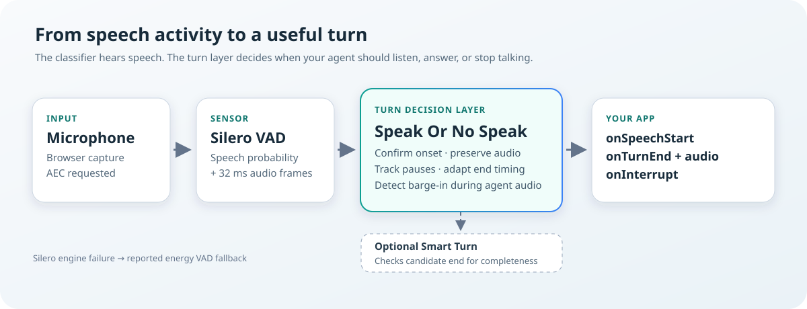

# Speak Or No Speak — Documentation

**Speak Or No Speak** is a browser JavaScript module that tells your voice
application when the user **starts speaking**, when they **finish a turn**,
and when they **barge in while the agent is answering** — built on Silero VAD,
adaptive endpointing, and browser echo cancellation, running entirely on the
user's device.

| Resource | Link |
|---|---|
| Live demo | <https://zushicat.github.io/speak-or-no-speak-dev/> |
| Demo code in this repo | [`demos/`](../demos) |
| Source module | [`src/`](../src) |

## How to read the documentation

| You want to … | Read |
|---|---|
| Understand what this is, in plain words | [1 What is Speak Or No Speak?](01-plain-english.md) |
| See it running right now | [2 Quick start](02-quick-start.md) → [3 The demo page](03-demo-page.md) |
| Put the module into your own app | [4 Use it in your own app](04-use-in-your-app.md) → [5 API reference](05-api-reference.md) |
| Build a talking agent (TTS + barge-in) | [6 Agent integration](06-agent-integration.md) |
| Understand how detection works under the hood | [7 How detection works](07-how-detection-works.md) → [8 Architecture](08-architecture.md) → [9 Engines and runtime libraries](09-engines-and-libraries.md) |
| Use the optional extras | [10 Smart Turn](10-smart-turn.md) · [11 Transcription](11-transcription.md) |
| Tune thresholds or debug behavior | [12 Configuration & tuning](12-tuning.md) → [13 Troubleshooting](13-troubleshooting.md) |
| Work on the source code | [14 Development: build, test & publish](14-development.md) |
| Learn why it was designed this way | [15 Design background](15-design-background.md) |
| Look up a term | [Glossary](appendix-glossary.md) |

## Table of contents

### Basics

1. **[What is Speak Or No Speak?](01-plain-english.md)** — the problem in plain words · what the module is (and is not) · where it fits in a voice app
2. **[Quick start](02-quick-start.md)** — requirements · starting the server · the demo walkthrough · what you should see · the optional STT stub and Smart Turn weights · quick troubleshooting
3. **[The demo page](03-demo-page.md)** — page anatomy · listening indicator · computer-voice row (the echo experiment) · background noise · transcription row · the Python stub · URL parameters · bundle variants · suggested experiments
4. **[Use it in your own app](04-use-in-your-app.md)** — the four integration modes · zero-build page · ESM bundle · IIFE bundle · npm/bundler · serving requirements · choosing a mode

### Reference

5. **[API reference](05-api-reference.md)** — `createSpeakOrNoSpeak` · options · thresholds · facade members · the agent-audio route · events & payloads · error codes · all 20 exports · debug handles
6. **[Agent integration](06-agent-integration.md)** — the echo hazard · the `setAgentSpeaking` contract · behavior while armed · the interrupt event · the post-interrupt rules · AEC scope per browser · the agent-audio route · OS-level AEC · a complete agent loop · pitfalls

### Under the hood

7. **[How detection works](07-how-detection-works.md)** — frames & probability · hysteresis · onset confirmation · the state machine · adaptive redemption · interior pauses · turn guards · barge-in confirm & grace · worked examples · turn audio
8. **[Architecture](08-architecture.md)** — component map · data flow · engine abstraction · facade wiring · the pure state machine · audio capture pipeline · threading model · design decisions
9. **[Engines and runtime libraries](09-engines-and-libraries.md)** — why Silero · vad-web's role & dual-mode resolution · runtime-verified findings · the AudioWorklet hang & the ScriptProcessor fallback · the energy fallback · the two CDN libraries · why neither is bundled · offline operation · upgrading the pins
10. **[Smart Turn](10-smart-turn.md)** — the optional end-of-turn model · when it runs & fail-open semantics · the Whisper feature pipeline · setup · measured performance · when to use it
11. **[Transcription](11-transcription.md)** — the hard rule · `SttAdapter` · `CloudStubAdapter` · the OpenAI-compatible pattern · Web Speech alternative · writing your own adapter · privacy & security

### Operating the module

12. **[Configuration & tuning](12-tuning.md)** — option merging · every threshold explained · the 32 ms recalibration story · tuning recipes · surfacing degraded flags · debug traces
13. **[Troubleshooting](13-troubleshooting.md)** — the degradation ladder · error codes · symptom → fix table · browser quirks · known limitations
14. **[Development: build, test & publish](14-development.md)** — repository layout · the zero-build philosophy · bundle artifacts · the build script · unit tests · replay harness & calibration recordings · publishing

### Appendix

15. **[Design background](15-design-background.md)** — the problem analysis · candidate solutions A–H and their scores · why the hybrid won · references
- **[Glossary](appendix-glossary.md)** — the vocabulary used throughout

---

*Return to the [project README](../README.md)*
